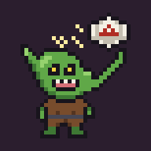

# Di en Di



Hoja de personaje interactiva para Android con las reglas de D&D 2024 (SRD 5.2), en español e inglés.

## Qué hace

- **Hoja de personaje con el diseño de la hoja oficial 2024** (dos páginas, editable directamente): cabecera con nivel/PX, CA con escudo, PG, dados de golpe y salvaciones contra la muerte; características con sus salvaciones y habilidades debajo; armas y trucos de daño; rasgos de clase, atributos de especie y dotes; entrenamiento con equipo; aptitud mágica, espacios de conjuro y tabla de conjuros (C/R/M); aspecto con **imagen del personaje**, historia, alineamiento, idiomas, equipo, sintonización y monedas.
- **Habilidades explicadas**: al tocar una característica, salvación o habilidad ves qué cubre, cómo se calcula tu bonificador y las *limitaciones actuales* (p. ej. desventaja por Envenenado, fallo automático por Cegado, penalización por agotamiento). Tirar el dado al tocar es opcional (Ajustes → «Tirar dados al tocar una estadística», desactivado por defecto).
- **Burbuja de información**: mantén pulsada 1,5 s una habilidad, salvación, característica, arma, conjuro, rasgo, recurso, condición o efecto y aparece una burbuja con lo que hace y lo que te limita *ahora mismo* (espacios que te quedan, concentración que perderías, Furia que impide lanzar conjuros, condiciones que te incapacitan, ventaja/desventaja…). Incluye una base de unos 80 conjuros habituales (SRD 5.2) en español e inglés.
- **Conjuros con sus componentes** como en el manual (**V** verbal, **S** somático, **M** material, más C de concentración y R de ritual) y rasgos marcados con cómo se recuperan (⛺ descanso corto, 🌙 descanso largo, ✨ espacio de conjuro, ♾️ a voluntad).
- **Avisos de la ficha**: un panel señala datos que faltan (clase, especie, trasfondo, salvaciones, espacios de conjuro…) y cosas que no cuadran con las reglas 2024 (salvaciones que no son las de tu clase, PG imposibles, puntuaciones por encima de 20, conjuros de nivel demasiado alto, pericia sin rasgo, dado de golpe incorrecto, escudo sin entrenamiento, PX para subir de nivel…) y las **competencias que te da tu clase** (armaduras, armas, herramientas, salvaciones, número de habilidades, armas marciales sin competencia), muchas con un botón **Corregir**. Cada aviso explica el motivo y se puede **ignorar** para que no vuelva a aparecer (y restaurar después).
- **Español / inglés**: toda la app (interfaz, reglas, avisos del motor, asistente y textos de IA) cambia de idioma desde Ajustes.
- **Importar una hoja real, gratis y sin conexión**: desde un PDF rellenable de la hoja oficial 2024 (cada campo se identifica por su posición; prácticamente perfecto), un Word (.docx) o texto (intérprete de etiquetas como «FUE 15», «CA 14», «Clase: Pícaro»), o una foto / PDF escaneado con **OCR dentro del móvil** (Tesseract.js). Siempre ves una vista previa antes de crear el personaje o reemplazar el actual. Los términos importados (equipo, armas, idiomas, competencias, especie, alineamiento, conjuros y rasgos) **se traducen al idioma de la app** con un glosario de D&D sin conexión; la historia y los textos largos se traducen con Claude si tienes clave. También puedes traducir una ficha ya creada desde Ajustes. Opcionalmente, con tu clave de Claude, las fotos se leen con más precisión.
- **Estilo retro**: fondo de D&D noventero con castillo y estrellas en pixel art, paneles con esquinas doradas y títulos con fuente pixel (incluida, funciona sin internet), y transiciones a pantalla completa estilo encuentro de RPG al entrar en combate («¡COMBATE!») y al subir de nivel («¡SUBES DE NIVEL!», «¡NIVEL 4!»).
- **App para Windows** (`Di en Di.exe`, en el artefacto `di-en-di-windows`): la misma app que en el móvil, en una ventana propia, para jugar sin ser el DM.
- **Temas de color**: Básico, Verdoso, Grises y Azules (Ajustes → Colores).
- **Pensada también para tablets** (hasta 16"): navegación lateral, diario como panel lateral, combate y reglas a dos o tres columnas, y en pantallas muy anchas las dos páginas de la hoja lado a lado.
- **Asistente en lenguaje natural** (funciona sin internet). Escribe o dicta frases como:
  - «Un goblin me ha atacado y me ha hecho 7 de daño cortante»
  - «El orco saca 15 para impactar y me hace 9» (compara con tu CA)
  - «Me lanzan bendición», «entro en furia», «se acaba la bendición»
  - «Estoy envenenado», «ya no estoy derribado», «me levanto»
  - «Me bebo una poción de curación», «gano 5 PG temporales»
  - «Tiro percepción», «salvación de destreza», «tira 2d6+3»
  - «¿Qué hace derribado?», «qué es sigilo»
  - «Descanso corto gastando 2 dados», «descanso largo», «fin de turno»

  El daño se aplica en el orden de las reglas 2024: inmunidad → resistencia → vulnerabilidad → PG temporales → PG. Avisa de la salvación de concentración (CD 10 o mitad del daño, máx. 30) y la tira por ti, gestiona caer a 0 PG, muerte instantánea, salvaciones contra la muerte y fallos por recibir daño a 0 PG. Cada cambio se puede **deshacer**.
- **Beneficios y perjuicios**: Bendición, Perdición, Escudo de la fe, Escudo, Celeridad, Lentitud, Furia, Esquivar, Armadura de mago, Piel robliza… con duración en rondas que baja sola al pasar turno, más efectos personalizados.
- **Modo combate**: al empezar te pregunta tu tirada de iniciativa (la escribes o la tira la app, nunca sola); **orden de iniciativa** con tus compañeros y los enemigos en burbujas que se reordenan arrastrando, con **su vida** (los enemigos empiezan con «?» y se va sumando el daño que reciben hasta que pongas su máximo). En cada turno anotas, sin dados, si quien juega **ha pegado, curado, recibido daño o hecho otra cosa** (hablar, moverse, esquivar… con texto libre) y a quién; si te pegan a ti se aplican tus resistencias y temporales. Opcionalmente (Ajustes) puedes escribir también la tirada. Además: acción / acción adicional / reacción, movimiento restante, conjuros con alcance y espacios, recursos, efectos activos y una chuleta de todas las acciones 2024.
- **Bloc de notas abatible** (botón 📜, disponible en todas las pantallas) con **carpetas** (Nombres, Lugares, Misiones, Objetos, Crónicas y las que crees): notas rápidas y un botón para **grabar la sesión**. La transcripción se convierte en una crónica escrita como un relato (con Claude) y se guarda en «Crónicas».
- **Reglas consultables**: condiciones, habilidades (con tu bonificador), acciones, reglas clave (ventaja, crítico, concentración, descansos, cobertura, agarre…), maestrías de armas y efectos, con buscador.
- Varios personajes y creación guiada por clase (PG, salvaciones, espacios y recursos automáticos).
- **Subir de nivel** (botón ⬆️ en la hoja): una pantalla te enseña lo que ganas en el siguiente nivel según tu clase (rasgos explicados, espacios de conjuro, recursos, bonificador por competencia) y te deja elegir lo que permiten las reglas 2024: PG (media fija o tirada), subclase, mejora de característica o dote, don épico, estilo de combate, pericias, metamagia, invocaciones, opciones de clase y conjuros nuevos de tu lista. Antes de confirmar ves un **resumen** de cómo quedará la ficha (PG máximos 10 → 16, características, competencia, CD, espacios, recursos) y los rasgos y conjuros que se añaden, indicando si se recuperan con descanso corto, largo, gastando un espacio de conjuro o a voluntad. Al pulsar **LVL UP** se actualiza toda la ficha.
- **PG temporales** sumados a tu vida (p. ej. «51/45 (45 + 6 temp.)»), y al tocar un conjuro o un rasgo ves qué hace, con un botón para editarlo.
- **Copia de seguridad** (Ajustes → Copia de seguridad): exporta todas tus fichas con su progreso y su diario (notas, carpetas y crónicas), o solo la ficha actual, a un archivo `.json`. En Android se guarda en *Documentos/DiEnDi* y se abre el menú Compartir para mandarlo a Drive, al correo, etc. Para recuperarlo, «Restaurar copia» deja **añadirlo a tus fichas** (las que ya existen se actualizan) o **reemplazarlo todo**. Sirve para no perder datos al reinstalar o para pasar tus personajes a otro móvil.

## Partida compartida (modo party)

El DM ejecuta un pequeño servidor en su PC con Windows y todos jugáis el mismo combate desde la app (o el navegador):

- **Party**: cada jugador comparte un resumen de su ficha (vida, CA, percepción pasiva, condiciones); la ficha completa sigue en su móvil.
- **Combate por turnos compartido**: orden de iniciativa, turno actual y vida en tiempo real. Cada jugador anota en su turno el daño que hace, curaciones, daño recibido u otras acciones. Si a ti te pegan, se aplica en tu ficha con tus resistencias y PG temporales.
- **Vida de los monstruos**: los jugadores ven «?» y su estado (**Ileso**, **Herido**, **Ensangrentado** —por debajo de la mitad—, **Derrotado**); el DM ve siempre la vida exacta y puede mostrarla si quiere.
- **Deshacer último turno**: revierte los daños y curaciones del turno (también en las fichas de los jugadores). Puede hacerlo el DM o el jugador cuyo turno se deshace.
- **Registro del combate** con todo lo ocurrido (lo deshecho aparece tachado), que se puede guardar en el diario.
- **Pantalla del DM**: monstruos del SRD 5.2 con buscador, grupos (p. ej. 4 goblins) con PG medios o tirados e iniciativa automática, **monstruos ocultos** que los jugadores no reciben hasta que el DM los revela, PNJ aliados, notas privadas, editar vida/CA/iniciativa y actuar por los monstruos en su turno. Lo oculto no se envía nunca a los móviles de los jugadores.

- **Preparación con «Listo»**: al empezar un combate salta la transición «¡COMBATE!», cada jugador introduce su iniciativa y su vida, ve los datos de sus aliados y pulsa **Listo** (se puede quitar si se ha equivocado). Cuando todos los jugadores y el DM están listos empiezan los turnos («¡A LUCHAR!»). El DM puede empezar sin esperar.
- **DM desde el móvil o la tablet**: en **Partida** marca «Soy el DM» y pon la clave del DM. La app pasa a modo DM, sin ficha: **Partida** y **Personajes** (aliados y enemigos con nivel/VD, vida, CA, iniciativa y notas, para meterlos en el combate con un toque, visibles u ocultos). La lista se guarda en el servidor.

**Montarlo** (instrucciones completas en `server/LEEME.txt`):
1. Descarga el artefacto `di-en-di-windows` de GitHub Actions y abre `Di en Di - Servidor.exe`. Se abre la pantalla del DM en el navegador y la ventana muestra el código de la partida.
2. En la misma Wi-Fi, los jugadores ponen en la pestaña **Partida** la dirección `http://192.168.x.x:3000` y el código.
3. A distancia, sin Cloudflare: instala [Tailscale](https://tailscale.com/download/windows) en el PC y ejecuta `tailscale funnel 3000`; comparte la dirección `https://….ts.net`. Los jugadores no instalan nada.

Para desarrollo: `npm run server` arranca el servidor con la app compilada.

## Inteligencia artificial (opcional)

En **Ajustes** puedes poner una clave de API de Anthropic (console.anthropic.com). Con ella:

- El asistente entiende frases que el intérprete local no reconoce.
- Las grabaciones del diario se reescriben como capítulos de una historia, con una lista final de nombres, pistas y misiones.
- Las fotos de fichas se leen con más precisión que con el OCR sin conexión (incluidas las casillas marcadas).

La clave se guarda solo en el móvil y se envía únicamente a la API de Anthropic. Modelo por defecto: `claude-opus-5-5` (se puede cambiar en Ajustes). Sin clave, todo lo demás funciona sin conexión.

## Desarrollo

```bash
npm install
npm run dev        # versión web en http://localhost:5173
npm test           # pruebas del motor de reglas
```

## Generar el APK

### Opción A: GitHub Actions (sin instalar nada)

Sube el proyecto a un repositorio de GitHub. El workflow `.github/workflows/android.yml` compila el APK en cada push a `main` (o a mano desde la pestaña *Actions*). Descárgalo desde los *Artifacts* de la ejecución, pásalo al móvil e instálalo (permite «instalar apps de origen desconocido»).

### Opción B: en tu ordenador

Necesitas Node 22, JDK 21 y Android Studio (con el SDK de Android 35).

```bash
npm install
npm run android    # compila la web, sincroniza y abre Android Studio
```

En Android Studio pulsa ▶ con el móvil conectado (depuración USB activada), o usa `npm run apk` para generar `android/app/build/outputs/apk/debug/Di en Di.apk`.

El reconocimiento de voz usa el servicio del sistema de Android (Google). Para grabar sesiones largas la app reinicia la escucha automáticamente tras cada pausa.

## Icono

El icono (un goblin en pixel art que mira a cámara y lanza dados) se genera con `python3 scripts/icon/goblin.py`, que crea todos los tamaños de Android, el icono adaptativo, la pantalla de carga y los iconos web a partir de una cuadrícula de 40×40 dibujada por capas en el propio script.

## Estructura

- `src/rules/srd.ts`: datos de reglas 2024 (habilidades, condiciones, acciones, clases, espacios de conjuro, efectos).
- `src/rules/calc.ts`: cálculos derivados (CA, velocidad, bonificadores, ventaja/desventaja según condiciones, tiradas).
- `src/rules/engine.ts`: aplicación de daño, curación, descansos, rondas, salvaciones contra la muerte…
- `src/rules/parser.ts`: intérprete de frases en español e inglés.
- `src/rules/spells.ts`: conjuros habituales con su resumen (ES/EN).
- `src/rules/glossary.ts`: glosario de términos de D&D inglés ↔ español para traducir fichas.
- `src/rules/explain.ts`: contenido de la burbuja de información.
- `src/rules/progression.ts` y `src/rules/levelup.ts`: progresión de clases 1-20 y subida de nivel.
- `src/rules/flags.ts`: avisos de datos que faltan o incompatibles con las reglas.
- `src/i18n.ts`: idioma de la app (`T('texto', 'text')`).
- `src/importer.ts`: importación de fichas (pdf.js para PDF, mammoth para Word).
- `src/offline/`: importación sin IA: `pdfForm.ts` (formularios PDF por posición), `textParse.ts` (texto libre), `ocr.ts` (OCR con Tesseract.js). El script `scripts/copy-ocr-assets.mjs` copia el motor y los idiomas a `public/ocr` al compilar, para que funcione sin internet.
- `src/backup.ts`: copias de seguridad (exportar a archivo, leer y fusionar).
- `src/party/`: partida compartida: protocolo, lógica de la sala (`room.ts`, también la usa el servidor), cliente WebSocket y monstruos del SRD.
- `server/index.ts`: servidor de partida (Node + WebSocket) que se empaqueta como `.exe` para Windows.
- `src/ai.ts`: integración opcional con Claude.
- `src/speech.ts`: reconocimiento de voz (plugin nativo / Web Speech API).
- `src/components/`: pantallas.

## Licencias

Código de terceros incluido: Tesseract.js y sus modelos de idioma (Apache 2.0), pdf.js (Apache 2.0), mammoth (BSD-2). La plantilla PDF oficial de la hoja de personaje es de Wizards of the Coast y no se incluye: la app solo lee la copia que tenga cada usuario.

## Licencia de contenido

Los textos de reglas se basan en el System Reference Document 5.2 de Wizards of the Coast LLC, disponible bajo licencia [Creative Commons Attribution 4.0](https://creativecommons.org/licenses/by/4.0/legalcode), traducidos y resumidos. Esta app no está afiliada ni respaldada por Wizards of the Coast.
